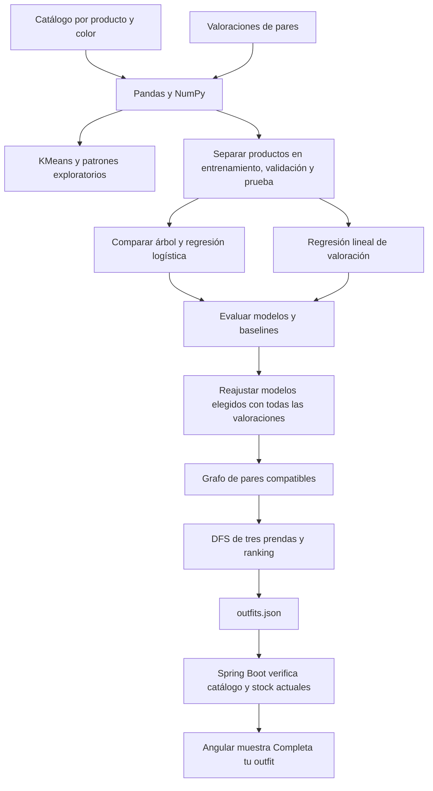

# Monarka ML

Analizador educativo de patrones de prendas y recomendador de outfits para Monarka.
Incluye una demo reproducible, un notebook para Colab y exportación JSON para Spring Boot.

[](https://colab.research.google.com/github/Oscar-h23/Monarca-ML/blob/main/notebooks/monarka_ml.ipynb)

## Ejecutar

Python 3.11 o superior. Desde la raíz del repositorio.

```bash
python -m venv .venv
source .venv/bin/activate
python -m pip install -r requirements.txt
python -m src.ejecutar
python -m unittest discover -s tests -v
```

En Windows activa el entorno con `.venv\Scripts\activate`.
Los CSV de `data/demo` contienen 80 prendas y valoraciones sintéticas generadas mediante
una regla con ruido. Sirven para ejecutar y explicar el flujo. Las métricas de la demo
miden la recuperación de esa regla simulada; la calidad en moda real requiere etiquetas
humanas y evaluación con usuarios. Regeneración opcional `python -m src.demo`.

## Estructura

```text
data/demo/                 Catálogo y valoraciones sintéticas
notebooks/monarka_ml.ipynb  Recorrido de clase ejecutable en Colab
src/preparar_datos.py       Validación, variables simétricas y particiones por producto
src/analizar_patrones.py    Estadística y KMeans exploratorio
src/entrenar.py             Árbol, logística, regresión lineal y baselines
src/generar_outfits.py      Grafo, DFS y ranking de conjuntos
src/ejecutar.py             Entrada y exportación de resultados
src/demo.py                 Generador explícito de la simulación
docs/integracion.md         CSV real y contrato Java/Angular
tests/test_outfits.py       Integridad del grafo y particiones
```

## Flujo



## Relación con las clases

| Tema | Aplicación |
| --- | --- |
| IA y NumPy | Media, mediana, desviación y detección de atípicos IQR de precios |
| Pandas | Lectura, validación, agregación de evaluadores y tablas de patrones |
| Aprendizaje no supervisado | KMeans agrupa prendas; k entre 2 y 5 según silueta cuando es viable |
| Clasificación supervisada | Árbol y logística predicen si el promedio de valoración será >= 4 |
| Regresión lineal | Estima la valoración en escala 1–5 para ordenar las combinaciones |
| Grafos y búsqueda en profundidad | DFS construye conjuntos comprobando compatibilidad entre todos los pares |
| Transformación digital | Recomendaciones en la ficha y resultados medibles frente a reglas sencillas |

KMeans es una exploración del catálogo y no decide las aristas del grafo. DFS construye
los conjuntos usando predicciones del clasificador. El precio se usa como señal exploratoria;
su utilidad debe revisarse con los datos reales. La afinidad estética depende de las etiquetas.
El alcance cubre estos conceptos; aprendizaje por refuerzo y semisupervisado quedan como temas teóricos.

## Evaluación

Se separan los productos 60/20/20 con semilla 23. Todos los colores de un mismo producto
pertenecen a la misma partición. Se usan únicamente pares con ambos productos en la misma
partición. Esto excluye pares cruzados e impide compartir productos entre entrenamiento y prueba.
El programa informa un error si faltan pares o alguna clase en una partición.
Se necesitan al menos 15 productos, pero la cantidad de valoraciones suficiente depende
de cómo estén distribuidas. Revisar ambas clases en las tres particiones.

Se elige entre árbol y logística por F1 de validación. Después se calcula una sola evaluación
final sobre prueba. Se reportan accuracy, precisión, recall y F1. Se comparan con clase
mayoritaria y mismo estilo. La regresión reporta MAE con predicciones recortadas a 1–5
y lo compara con predecir siempre la media de entrenamiento.

Después de evaluar se reajustan los modelos con todas las etiquetas para exportar los outfits.
Las métricas y `arbol_evaluado.txt` corresponden a los modelos previos a ese reajuste.
Para valorar conjuntos completos, pedir a evaluadores externos que comparen los outfits
con una selección de categorías distintas y mismo estilo, sin revelar el método.

## Salidas

`resultados/metricas.json`, `estadisticas.json`, `clusters.csv`, `patrones.csv`,
`arbol_evaluado.txt`, `analisis.png` y `outfits.json`. Los resultados se generan localmente
y se excluyen de Git. Los patrones reflejan catálogo y valoraciones, y no hábitos de compra.

## Usar datos reales

Consulta [formato y conexión con Monarka](docs/integracion.md).

```bash
python -m src.ejecutar --catalogo data/reales/catalogo.csv --valoraciones data/reales/valoraciones.csv
```

Los cambios de Spring Boot y Angular son la siguiente integración. Este repositorio entrega
el pipeline y su contrato JSON, sin conectarse directamente a la base de datos.

## Referencias técnicas

- [Pipelines y prevención de fuga de datos](https://scikit-learn.org/stable/common_pitfalls.html)
- [ColumnTransformer y variables mixtas](https://scikit-learn.org/stable/auto_examples/compose/plot_column_transformer_mixed_types.html)
- [KMeans](https://scikit-learn.org/stable/modules/generated/sklearn.cluster.KMeans.html)
- [Evaluación de modelos](https://scikit-learn.org/stable/modules/model_evaluation.html)
